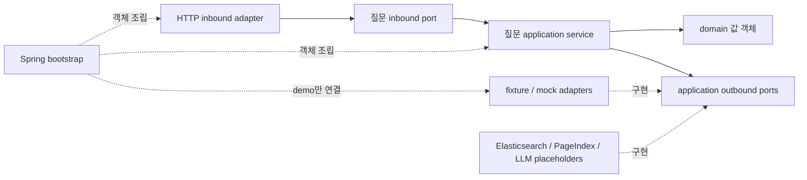
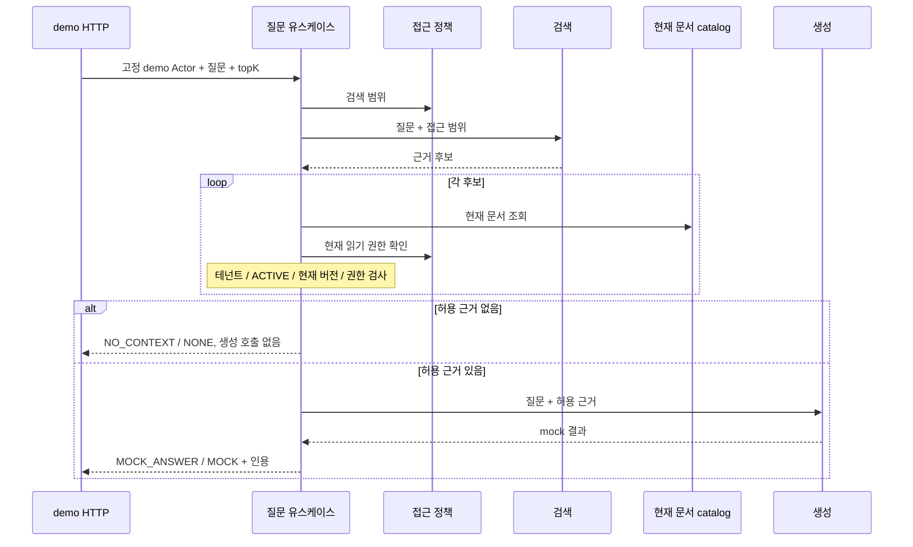

# 아키텍처와 선택 근거

## 목표와 경계

범용 RAG 서비스의 구조와 계약을 준비한다. 실제 검색·모델 생성이나 운영 API·보안의 완성을 주장하지 않는다. 범용 문서/근거 모델을 사용하고 MRO 전용 개념은 추가하지 않는다.

단일 배포 가능한 모듈형 헥사고날 구조를 선택했다. 컴파일 모듈은 경계를 강제하는 장치이며 독립 서비스나 네트워크 경계가 아니다.

실선은 소스 의존성/호출, 점선은 구현/조립 관계다. application은 adapter 구현 클래스를 알지 못한다.

| 모듈 | 책임 | 허용 운영 의존성 |
|---|---|---|
| `rag-domain` | 호출자·문서·검색 근거의 값과 불변 조건 | JDK |
| `rag-application` | 질문 유스케이스·DTO·포트·향후 문서 변경 계약 | domain, JDK |
| `rag-adapters` | HTTP/직렬화/검증·stub·외부 구현 자리 | application, domain, Spring/Jakarta |
| `rag-bootstrap` | 메인 클래스·프로필·설정·구현 선택 | 위 세 모듈, Spring Boot |
| `rag-architecture-tests` | 코어 격리·모듈 경계·순환 의존 검증 | 테스트 전용 |

## 대안과 선택

- 단일 Maven 모듈+패키지 경계는 단순하지만 코어에 Spring/SDK를 넣기 쉬워진다. 이 포트폴리오는 컴파일 경계를 설명해야 하므로 운영 네 모듈을 택했다.
- 현재의 멀티모듈 모놀리스는 별도 서비스 운영 비용 없이 의존성과 교체 지점을 보여준다. POM·검증 모듈이 늘어나는 비용은 수용한다.
- 수집/검색/생성 마이크로서비스는 독립 확장·팀 소유권·장애 격리 요구가 있을 때 고려한다. 현재 그 근거가 없어 제외했다.

검색·생성·문서 조회·접근 제어·관측성은 외부 시스템 또는 정책이 달라질 근거가 있어 포트로 분리한다. 나머지 값 객체에 의미 없는 인터페이스를 추가하지 않는다.

## 계약

| 계약 | 의미 |
|---|---|
| `AskQuestionUseCase` / `AskQuestionCommand` | 내부 `Actor`, 질문, topK로 질의 |
| `AnswerResult` / `Citation` | outcome, answer, citations, generationMode와 문서 버전/locator |
| `RetrieveEvidencePort` | 접근 범위를 포함한 검색 요청 → 근거 후보 |
| `GenerateAnswerPort` | 승인된 근거만 포함한 생성 요청 → 결과 |
| `DocumentCatalogPort` | 현재 문서 메타데이터·버전·상태 조회 |
| `AccessPolicyPort` | 검색 전 범위 결정·후보별 현재 읽기 권한 확인 |
| `ObservationPort` | 원문 없는 결과/시간/실패 관측 |

포트의 소유자는 application이다. adapter는 SDK 요청/응답을 내부 값으로 변환한다. 도메인/유스케이스에는 Spring annotation, SDK DTO, HTTP 상태 코드를 넣지 않는다.

## 최소 질문 흐름

검색 인덱스는 권한/버전의 신뢰 원천이 아니다. catalog와 access policy를 다시 확인한다. 인용은 허용 근거에서만 구성한다. 이 최소 검사는 권한 검사 직후의 취소 경쟁 조건을 완전히 막지 못한다. 운영 보완은 [권한/문서 생명주기](security-and-lifecycle.md)에 남겼다.

## 외부 구현 지점

Elasticsearch와 PageIndex는 같은 검색 포트의 구현 후보다. PageIndex 내부 알고리즘·스키마·LLM 필요 여부는 이 뼈대에서 가정하지 않는다. 실제 채택할 공식 구현/프로토콜을 검증하고 권한 범위·버전·locator·실패 의미를 매핑해야 한다. 같은 문서 snapshot으로 비교한다.

외부 모델은 생성 포트의 구현으로 추가한다. streaming/SDK/토큰 객체는 adapter 안에 둔다. 현재 미구현 어댑터는 명시적 예외를 던지고 demo에 연결하지 않는다. 외부 설정만 넣어 실제 통신이 시작되지는 않는다.

문서 parsing/OCR·chunking·embedding·reranking은 아직 구현하지 않았다. 수집/색인 파이프라인과 검색 adapter의 후속 작업으로 두며 선택한 전략에 필요한 것만 추가한다. 현재 catalog 포트는 메타데이터 조회용이고 원본 blob 저장소가 아니다. 원본 읽기/저장 계약은 실제 수집 유스케이스를 구현할 때 구체화한다.

관측은 원문 없는 포트에 결과/시간/오류 범주를 전달하고 향후 adapter가 Micrometer/OTel로 변환한다. exporter 실패가 본래 작업의 예외를 덮지 않도록 best effort다. 질의·문서 원문·API 키는 로그 태그로 사용하지 않는다.

## 기술 선택

공식 자료 확인 기준: 2026-10-27. 자동 최신 추종 대신 버전을 고정한다.

- Java 21 LTS: record/불변 컬렉션을 사용한다. 검증에 사용한 JDK는 Temurin 21.0.11이다.
- Spring Boot 4.1.2: 공식 stable 문서로 확인했으며 Java 21은 지원 범위다. 새 프로젝트로 기존 SDK 호환성 제약이 없다. 향후 Spring AI/모델 SDK를 고르면 버전 조합을 다시 확인한다. [공식 요구 사항](https://docs.spring.io/spring-boot/system-requirements.html)
- Maven 3.10.0: 공식 권장 stable이다. 선언적 reactor로 모듈 경계를 읽기 쉽고 Wrapper로 재현할 수 있다. Wrapper에 공식 배포 URL과 검증된 배포본의 체크섬을 고정한다. [공식 다운로드](https://maven.apache.org/download.cgi), [공식 Wrapper](https://maven.apache.org/tools/wrapper/)
- JUnit / ArchUnit: 기능 계약과 바이트코드 의존성 경계를 외부 서비스 없이 검사한다. ArchUnit은 테스트 전용이다. [공식 가이드](https://www.archunit.org/userguide/html/000_Index.html)

Maven/공개 의존성의 최초 다운로드는 빌드 준비이며 외부 RAG·모델 호출과 구분한다. 실제 버전·실행 명령·테스트 수는 [검증 기록](verification.md)이 기준이다.
