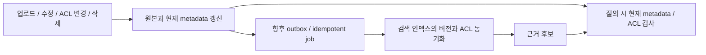

# 권한과 문서 변경의 확장 지점

## 현재 범위

demo 호출자는 bootstrap에서 고정하고 요청 body/header로 신원을 만들지 않는다. fixture 접근 정책은 운영 인증/인가가 아니다. 기본은 비웹이며 demo는 loopback을 기본값으로 쓴다. Spring Security, OIDC, 세션, CSRF/CORS 정책, rate limit, 감사 저장소는 미구현이다.

질문 흐름은 검색 전 접근 범위를 결정하고 후보마다 현재 catalog의 테넌트·버전·ACTIVE 상태와 읽기 권한을 재확인한다. 허용된 근거가 없으면 생성하지 않는다. 원문이 해당 버전의 진짜 내용인지 보증하는 content hash/signature는 아직 없다.

## 운영 확장 순서

1. HTTP adapter에서 검증된 OIDC/JWT principal을 내부 `Actor`로 변환한다. 임의 헤더의 테넌트를 그대로 신뢰하지 않는다.
2. 접근 포트 뒤에 권한 저장소/정책 엔진을 붙이고 검색 범위와 재검사에 같은 policy revision을 전달한다.
3. catalog를 authoritative 저장소에 연결해 tenant/document/version/content hash/ACL revision/tombstone을 관리한다.
4. 검색 pre-filter를 적용한다. 이를 지원하지 않는 전략은 corpus 또는 인덱스 격리로 같은 신뢰 경계를 만족시킨다.
5. 긴 LLM 호출 중 권한 취소/삭제의 정책을 정한다. 생성 직전·응답 직전 재검사, snapshot 유효기간, 취소/타임아웃을 설계한다.
6. 프롬프트 인젝션, 민감정보, 모델 제공자의 데이터 보관/전송 정책을 검토한다. 문서의 지시문을 시스템 명령으로 실행하지 않는다.

허용 문서 ID를 매번 전송하는 demo 범위 모델은 대규모 조직에 맞지 않는다. 정책 필터/참조로 교체해도 검색과 재검사의 의미는 유지해야 한다.

## 문서 생명주기

application의 문서 변경/색인 계약은 향후 확장용이다. 수집 worker, 저장 트랜잭션, outbox, 실제 색인·재처리·스케줄러는 구현하지 않았다. OpenAPI의 문서 쓰기 경로도 계획 항목이며 handler가 없다.

| 변경 | 향후 처리 | 질의 경로 보완 |
|---|---|---|
| 신규/본문 수정 | 새 불변 버전, content hash, idempotency key, 색인 상태 | 현재 버전과 다른 후보 제외 |
| ACL 변경 | revision 증가, 검색 필터/캐시 무효화 | 최신 권한 재검사, 취소 지연 정책 |
| 삭제 | authoritative tombstone 우선, 인덱스/원본 보존 정책 | DELETED/미존재 근거 차단 |
| 색인 실패 | 버전별 재시도, 중복/역순 이벤트 처리 | 미완료/오래된 근거 사용 정책 |
| 전략 교체 | 같은 snapshot으로 새 인덱스 평가 후 전환 | 인덱스 버전·문서 버전 함께 추적 |

문서 키는 테넌트와 함께 식별한다. 메모리 fixture는 영구 저장·동시성·중복 이벤트 처리를 보장하지 않는다.

관측 항목은 request/trace ID, policy revision, 전략/인덱스 버전, 필터 전후 개수, 지연, 모델/토큰/비용, 결과 범주다. 식별자도 가명화 여부를 검토한다. 원문·API 키를 로그에 남기지 않는다.

향후 회귀 테스트에는 다른 테넌트의 같은 ID, 검색 직후 권한 취소, 생성 중 삭제, ACL 동기화 지연, 중복/역순 변경 이벤트, 프롬프트 인젝션, provider timeout을 추가한다. 현재 실제 테스트 범위는 검증 기록과 소스가 기준이다.
